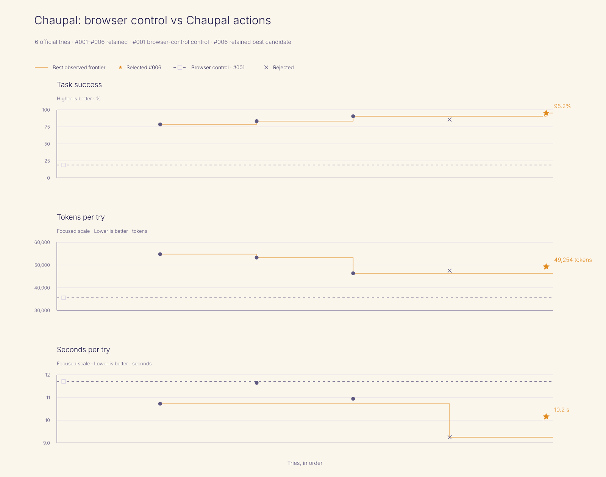

# Evaluation

The question is the base repo's question, asked in India: does Chaupal's action set turn an elder's spoken request into the right, visible, continuing activity more often than the same model working the same page without those actions?

## Method

The suite has 21 cases, frozen in [`evals/evals.json`](evals/evals.json) before the first official run; its SHA-256 is recorded in every iteration's manifest. Fifteen cases port the base repo's suite one to one (its calligraphy cases become Sulekh, its Janggi cases become shatranj, its two interface cases stay). Four are new for rangoli and kolam, and two for family play. Each prompt is written the way an elder would say it, in Hindi (Devanagari and Latin letters), Hinglish, Punjabi (Gurmukhi), Tamil and Marathi. Prompts carry only her intent; action names, schemas and mechanics never appear in them.

Every case runs twice under each condition, in a fresh household on a production build of the app, in headless Chromium with the camera stubbed to "denied":

- A, browser control: `claude-sonnet-5-5` with four browser tools (read the page, click, type, wait), the strongest fair attempt at working the visible interface. The page's type-to-agent box is disabled for this condition so the model cannot hand the task to Chaupal's own agent.
- B, Chaupal actions: the same model, same system prompt and same browser tools, plus Chaupal's agent-facing actions from its MCP catalog.

Scripted person actions play the elder's own part when a case needs it: drawing a stroke, dragging a piece, the grandson's move on a second browser context, tapping "मत भेजो" on the approval card.

Grading is route-neutral and reads the complete visible outcome: snapshots of her screen after every tool call, the family screen where there is one, and the live session state. A result counts only if it is on screen. Each case also carries the base repo's two standard checks: CONVERSATION-QUALITY-001 (an LLM judge, same model, scoring adult respect, clarity, warmth, agency and fit; it fails on tool narration, pity, false intimacy or a missing reply) and AGENT-TRUTH-001 (no claimed outcome without matching evidence on screen). A case passes only when every assertion passes.

Changes between candidate iterations are limited to one bounded part of the agent-facing surface at a time (a description, a schema, a result field or a guard). Acceptance is computed, not chosen, with the base repo's gate: beat the control; after the first accepted candidate, do not lose task success and improve tokens or time without getting more than 10% worse on either. Every iteration's artifacts are kept, including rejected ones.

## Results

<!-- results:start -->

Generated by `pnpm eval:results` from `evals/iterations/*/manifest.json` and `benchmark.json`. Do not edit by hand.

| Iteration | Condition | Decision | Task success | Critical | First-pass valid | Tokens/try | s/try | Failed calls | Retries | sulekh | rangoli | shatranj | family | interface |
|---|---|---|---:|---:|---:|---:|---:|---:|---:|---:|---:|---:|---:|---:|
| #001 | browser-control | control | 8/42 (19.0%) | 19.0% | 19.0% | 35,581 | 11.7 | 0 | 0 | 0/16 | 0/8 | 6/10 | 0/4 | 2/4 |
| #002 | chaupal-actions | accepted | 33/42 (78.6%) | 81.0% | 76.2% | 54,759 | 10.7 | 1 | 8 | 16/16 | 8/8 | 2/10 | 4/4 | 3/4 |
| #003 | chaupal-actions | accepted | 35/42 (83.3%) | 92.9% | 83.3% | 53,251 | 11.6 | 1 | 6 | 14/16 | 7/8 | 6/10 | 4/4 | 4/4 |
| #004 | chaupal-actions | accepted | 38/42 (90.5%) | 95.2% | 88.1% | 46,335 | 10.9 | 1 | 6 | 16/16 | 7/8 | 7/10 | 4/4 | 4/4 |
| #005 | chaupal-actions | rejected | 36/42 (85.7%) | 88.1% | 85.7% | 47,505 | 9.3 | 1 | 6 | 16/16 | 8/8 | 4/10 | 4/4 | 4/4 |

Model `claude-sonnet-5-5`, 21 frozen cases × 2 repetitions per iteration, 150 s per case. Tokens/try counts every input token (uncached, cache-write and cache-read) plus output tokens. The acceptance gate is computed in `evals/runner/trajectory.ts`.

<!-- results:end -->

## Other measurements

Indic render accuracy ([`evals/render-accuracy/results.md`](evals/render-accuracy/results.md)). Fifty phrases, ten per script in Devanagari, Gurmukhi, Tamil, Bengali and Urdu, rendered by the Sulekh provider and by an unshaped baseline that draws each code point's glyph left to right in the same font (the failure image models show with Indic text; it is a baseline, not an image model), then read back with Tesseract. With each script's calligraphic font, the shaped renders read back exactly 21/50 times and the unshaped baseline 8/50; with the plainest font per script, 31/50 against 13/50. Every shaped render had already passed exact-text validation, so each shaped miss is OCR misreading a correct render. OCR is weakest on Kalam, Galada and Nastaliq, which is why the plain-font control exists. In one script (Bengali, Galada) the unshaped baseline had the lower character error rate; we report it as measured.

Family sync: see the results block above for the latency from a move on one device to the other device's screen.

## What the numbers do not show

The cases run with a scripted elder, not a real one, and the voice step is replaced by typed text. They measure whether the agent reaches the right visible state, not whether an elder finds it pleasant or useful. The move resolver's known gaps are listed in the results block's failure categories; among them, spoken square names ("ई चार") and knight words like "ढाई घर" are not understood and lead to a question instead of a move.
